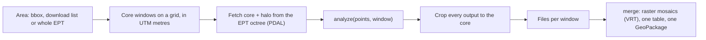
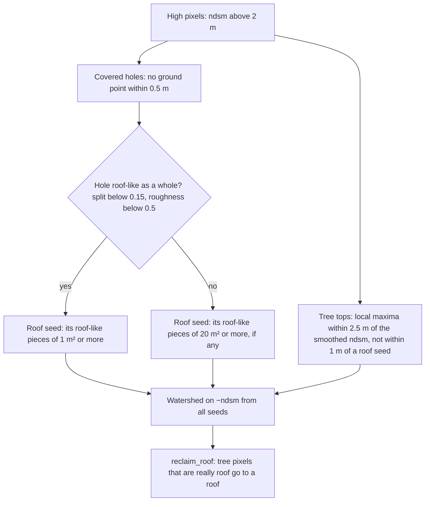
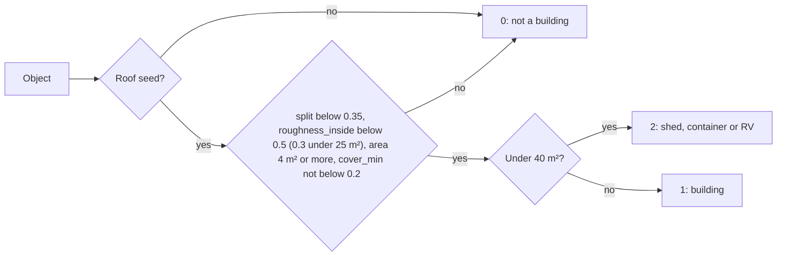
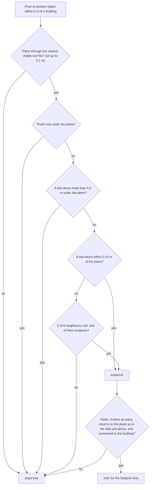

# Theoretical basis

How `src/tilestream.py` and `src/buildings.py` work, and why each step is justified. Constants
are given with their values. The numbers in brackets come from the two test sites in
WA_NorthEast_2_B22, at 12–15 pulses/m²: Chewelah (a town) and Nine Mile Falls (forest with
houses). `HANDOFF.md` has the history and `test/README.md` lists what each test checks.

State on 2026-11-09: sections 1–6 are in the code; section 7 (walls from the points) has been
measured but not built.

---

## 1. Reading lidar in windows (tilestream)

**The problem.** A 3DEP project is terabytes. An analysis has to run over areas far bigger
than memory, and its result must not depend on how the area was cut up.



An EPT is an octree of LAZ tiles. A box query reads only the nodes that touch the box, so a
window streams straight from S3 and nothing big lands on disk. The next window is fetched in a
background thread while the current one is analysed.

**Why it has no seams.** Suppose the analysis has a *reach* r: its output at a location p
depends only on points within r of p. A window fetches its core plus a halo h around it. For
every p in the core, all points within r of p are fetched if h ≥ r. Then the window's output at
p is exactly what one run over the whole area would give. Cores tile the plane with half-open
bounds (x0 ≤ x < x1), so each location is produced once. Raster grids are snapped to global
multiples of the pixel size, so the crop falls on pixel edges. Table rows and polygons are kept
by their point (x, y), so a polygon that reaches into the next window is written whole, by one
window only.

```
+-------------------------------+
| halo: fetched, not kept       |
|   +-----------------------+   |
|   | core: kept            |   |
|   |   * an object's point |   |
|   +-----------------------+   |
+-------------------------------+
```

For objects, the reach is the object's own size: how a building is cut out depends on all of
it. So `buildings.py` uses h = 50 m (objects up to ~100 m across), and gives each object one
point inside it: for a roof, its pixel furthest from any ground point; for a tree, its top. The
window that owns that point owns the object.

The seam tests taught two more requirements:

- **Results must not depend on where in a window something lies.** Ties are broken by pixel
  position (raster order), which is the same in every window. They are never broken by label
  numbers, which depend on what else is in the window.
- **Results must not depend on the order of the points**, which differs between windows. A
  float sum depends on order. Counts, minima, sorted sums and integer sums don't, so those are
  what the code uses.

The check: four 250 m windows against one or two 500 m windows give identical outputs.

---

## 2. Rasters: what the points say about surfaces

The points go onto a 0.5 m grid (`RES`): about 3–4 pulses per pixel at 15 pulses/m², which is
fine enough for a 2 × 3 m shed.

| raster | definition | what it shows |
|---|---|---|
| `dtm` | mean height of the ground points (class 2); empty pixels take the nearest ground pixel's | the ground, also under buildings |
| `dsm` | highest point (noise dropped); gaps up to 1 m filled | the top surface |
| `ndsm` | dsm − dtm | height above ground; objects are > 2 m (`MIN_HEIGHT`) |
| `ground_gap` | distance to the nearest pixel with a ground point | covered holes |
| `multi_return` | share of the pulses with more than one return, over 3 × 3 pixels | hard surface or foliage |
| `roughness` | \|Laplacian of the dsm\| | planar or bumpy |

Why these three clues tell roofs from trees:

- **A roof is opaque.** No pulse reaches the ground under it, so a building leaves a hole in
  the ground points with straight edges and a large `ground_gap` in its middle. A crown is
  porous: some pulses reach the ground, so its gaps stay small and scattered.
- **A roof stops a pulse at once.** A laser pulse lights a spot tens of centimetres across. On
  a hard surface all of it comes back at the same time: one return. In foliage, parts of the
  spot hit leaves at different depths, and the echo splits into several returns. So the share
  of split pulses is near 0 on roofs and high in trees.
- **A roof is made of planes.** For any plane z = a + bx + cy the Laplacian
  ∂²z/∂x² + ∂²z/∂y² is 0, so flat and evenly sloping roofs both have roughness 0. Only ridges
  and edges show up, as lines. A crown bends everywhere.

---

## 3. Objects: a seeded watershed (`segment`, `reclaim_roof`)



**The watershed.** Turn the ndsm upside down (−ndsm), so that tops become basins, and flood it
from the seeds. Each pixel goes to the seed whose flood reaches it first. Floods meet along the
valleys of the real surface: the saddle between two crowns, the drop from a roof to a crown. If
every local top were a seed, a roof would fall apart at each ridge and dormer. So there is one
seed per roof, made from its covered hole.

**Roof seeds.** A covered hole is a connected group of high pixels with no ground point in the
pixel or its four neighbours (`HOLE_GAP` = 0.5 m). It seeds a roof if, as a whole, it has few
split pulses (< 0.15) and is smooth (median roughness < 0.5 m). Only the hole's own roof-like
pixels become the seed, in pieces of at least 1 m², because a dense crown next to a building
also hides the ground. If no such piece exists, the whole hole is the seed: a small shed is
nearly all edge. A hole that runs on under trees can fail as a whole. Then only its roof-like
pieces of at least 20 m² (`ROOF_PIECE`) seed it, which are bigger than a crown's smooth bits.
In Chewelah 8 of 2,297 such holes have one, and 5 of them are buildings.

**Tree tops.** Local maxima of the ndsm, smoothed with a 0.5 m Gaussian, within 2.5 m: at 1.5 m,
big crowns split into 2–3 pieces. Tops within 1 m of a roof seed are dropped, since eaves and
parapets aren't trees. A high patch with neither kind of seed is seeded at its highest pixel.

**`reclaim_roof`.** The flood can call roof "tree" in three ways:

- a tree top lands on a roof section, so the section becomes a tree object;
- a crown floods along the eaves or a ridge, which look like trees (split pulses, sharp bends);
- a rooftop unit becomes a patch of "tree" in the middle of the roof.

The fixes, in the same order:

- A whole tree object next to a roof becomes roof if it has few split pulses (< 0.15, or < 0.2
  from 25 m² up). It goes in one piece to the roof it shares the longest border with.
- Thin pieces next to a roof become roof. An opening (an erosion, then a dilation) with a 1 m
  disk keeps only what the disk fits into, so it finds every piece narrower than ~2.5 m.
- A tree patch with roof all around it becomes roof. A real tree reaches past the roof's edge
  somewhere, down to lower ground.

Each tree object is made one piece again afterwards.

Each object then gets a row of features (`objects_table`): area, height, hole depth and share,
rectangularity, split share, roughness (also without the edge pixels: `roughness_inside`) and
metrics from its points.

---

## 4. The rule (`is_building`) and the vehicle clue (`cover_min`)



Each condition comes from objects labelled in QGIS:

- **Only roof-seeded objects.** Applying the rule to every object was tried. In Chewelah it
  added 26 footprints, many of them trees.
- **Split pulses below 0.35, over the whole object.** A dense crown can hide the ground and get
  a seed, but over all of it, its pulses split.
- **`roughness_inside` below 0.5 m, or below 0.3 under 25 m².** Roughness is taken without the
  edge pixels, where the Laplacian sees the drop to the ground: on a shed half the pixels are
  edge. Small objects must be smoother because a shed has a simple roof. Examples:

  | object | roughness_inside | result |
  |---|---|---|
  | a shed | 0.05 | passes |
  | a 16 m² bush | 0.36 | fails |
  | a rock (a dome) | 0.61 | fails |
  | a 180 m² house with a complex roof | 0.40 | passes |
- **At least 4 m².** The smallest checked shed is 7.5 m².
- **`cover_min` not below 0.2.** This is the vehicle guard, described next.

**`cover_min`.** Each flight line is one pass at one time. Chewelah has four lines: three
within 24 minutes and one three days later. For one line, `cover` is the share of its first
returns in the object's pixels that lie above 2 m.

- A building is there in every pass, so its cover is high in every line.
- A vehicle that came or went between passes is missing from one line, and its cover there is
  about 0.
- Only lines that reach at least half of the object's pixels count. A line that only grazes
  the edge sees mostly the ground beside it.

The data show a clear gap. The vehicles that moved score 0.00, while every roof-seeded object
scores at least 0.33. The guard is insurance: a moving vehicle rarely gets a roof seed anyway,
because another line saw the ground under it. A vehicle parked through all passes looks like a
shed, and nothing here can tell them apart.

---

## 5. Roof under the canopy (`roof_under_canopy`)

**Physics.** A crown lets a share of the pulses through: its gap probability. In canopy optics
this falls exponentially with the leaf area along the path. Over the tree notches in Chewelah,
20–55% of the pulses got through. A pulse that gets through ends on whatever lies below: the
roof if the roof continues under the tree, otherwise the ground.



Why each step:

- **The surface.** A roof facet is locally a plane. It is fitted to the dsm of the building's
  pixels within 1.5 m of the nearest visible roof pixel, in four rounds that each drop the
  pixels more than 0.3 m off. If it still doesn't fit within 0.1 m (a ridge, a step), there is
  no surface to continue. The plane is evaluated at each point's own position, so sloping
  roofs work too.
- **"On" is evidence; "under" is a veto.** A last return within 0.15 m of the surface means
  something stopped the pulse there. A last return more than 0.3 m under it means the pulse
  went through where the roof would be. Since a roof is opaque, one such return rules the pixel
  out. That is how the edge of a hidden roof is found: beyond it, pulses reach the ground.
- **The top must not be under the surface.** A tree lower than the roof isn't over it.
- **Filling gaps.** With n ≈ 3.5 pulses per pixel and a gap probability P ≈ 0.3, the chance
  that no pulse gets through a pixel is (1 − P)ⁿ ≈ 0.29. So about a third of the pixels have
  no evidence either way. Such a pixel joins if most of its neighbours are roof and one of them
  has evidence, so there is never roof without evidence nearby.
- **The thin layer.** The pixels were *chosen* because they have a return on the surface, so
  that alone proves little: in a dense crown, by a rough estimate, a quarter of the pixels have
  one by chance.
  What a real surface does is concentrate returns into a thin slab, while a crown spreads them
  through its depth. So each patch is compared with the 0.3 m slab just above the surface (the
  same thickness, and not selected for), and it must have at least 3 times as many returns on
  the surface. In Chewelah the roof found has 3,101 returns on the surface against 103 in the
  slab above (a median of 26 to 1 per building).
- **For the footprint only.** The rule has already judged the visible roof, so no building code
  can change. The crown keeps its whole shape, so crown and footprint overlap where the tree
  hangs over the roof, which is what is really there.

Result in Chewelah: 49 of 167 buildings gained 306 m² in all, and the tree-notch flags went from
32 to 13.

---

## 6. Polygons (`trace`, `straighten`, `tree_notch`)

Outlines run along the pixel edges (`gdal.Polygonize`), with holes under 1 m² filled (single
low pixels in a roof). Objects that aren't buildings are simplified with a 0.5 m tolerance.
Buildings get straight walls:

1. **Walls.** Douglas–Peucker cuts each ring into walls: keep the point furthest from the
   chord if it is more than 0.75 m off, and repeat on both halves. It starts at the point
   furthest from the centre, which is a real corner.
2. **The main direction.** A wall's direction θ is the same as θ + 180°, and in a rectilinear
   building as θ + 90°. Multiplying the angle by 4 makes walls at right angles point the same
   way. The direction is the mean of the vectors $w\,e^{4i\theta}$, divided by 4:

   $$z = \sum_k w_k e^{4i\theta_k}, \qquad \text{main} = \tfrac{1}{4}\arg z, \qquad \text{agree} = \frac{|z|}{\sum_k w_k} \in [0, 1].$$

   `agree` is the mean resultant length of circular statistics: 1 when all walls are at 0° or
   90° to each other. The weight w = length². Long walls are measured from many pixels and are
   rarely tree edges. In a second pass only walls within 15° of the first answer vote, so
   diagonal tree edges can't turn the building.
3. **A line through each wall.** Each wall is fitted by total least squares to its pixel
   edges, treated as line pieces. A piece of length ℓ adds its own spread ℓ²/12 along itself,
   so a staircase gives the line through its middle, and a single edge keeps its own direction.
4. **Snapping and corners.** A wall within 15° of the main direction (or square to it) is
   turned onto it. Diagonal walls of 4 m or more stay; shorter unsnapped bits are dropped.
   Corners are where neighbouring lines cross; parallel neighbours get a jog.
5. **Safety net.** Straightening is refused, with an `outline` code, if:
   - the building is under 25 m²;
   - the walls don't agree (agree < 0.7, mostly tree-bitten);
   - the result isn't a valid shape;
   - or the area changed more than 10%.

**Tree notch.** A diagonal wall of 4 m or more with mostly tree pixels just in front of it is
usually a tree over the roof's corner, not a wall. Such buildings get `review` = 1.

**A known bias.** A pixel counts as roof if any of its pulses hits the roof, so the pixel outline
lies outside the true roof edge. Section 7 measures how far.

---

## 7. Walls from the points (measured, not yet built)

A wall placed on pixel edges is good to about ±0.25 m. The points can do better.

**The estimate.** Cut the wall into slices of width s = 0.5 m along its length. In each slice,
take the roof point furthest out, d_max. Suppose the roof points form a random (Poisson) pattern
with ρ points per m². Then the chance of no point within a distance x of the edge, in one
slice, is $e^{-\rho s x}$. So the gap between the outermost point and the edge is exponential,
with mean $1/(\rho s)$ and median $\ln 2/(\rho s)$, about 0.10 m at ρ = 14. The edge is then

$$\hat e = \operatorname{median}_k\, d_{\max,k} + \frac{\ln 2}{\rho s}.$$

The median ignores the odd slice with a gutter, an antenna or a gap. Over the ~20 slices of a
10 m wall the error is about ±3 cm.

**Roof side only.** Two effects make the ground side unreliable:

- behind a building (seen from the scanner) the ground near the wall is in shadow;
- slanted pulses reach the ground *under* the eaves. In Chewelah the innermost ground point lies
  a median 0.16 m inside the roof's edge.

**Roof points.** These are first returns within 0.3 m of the roof surface fitted next to the
wall. Each slice gets its own height and the slices share one slope across the wall. A single
plane fails at gable ends, where the roof rises along the wall to the ridge.

**Result** (Chewelah, 559 straight walls): the walls move in by a median 0.15 m (middle half
0.10–0.20 m). That is the pixel bias, about 6% of the area of a 10 × 10 m house.

**Safety rules.** A wall keeps its place:

- if it isn't straight;
- if a tree or high points stand in front of it;
- if the surface fits poorly or too few slices have roof points;
- if it would move more than 0.5 m;
- or if moving it out would push it into a neighbour. That last rule is Michael's: neighbours
  at the same height pushed five walls out by ~1 m.

---

## 8. How we know it works

- **Seam tests:** different window layouts give identical outputs (section 1).
- **Synthetic scenes with known answers:** a house, a tree, a rock, a bush; a tree over a
  house's corner; a sloping roof under a crown.
- **Every rule has a test that fails without it.** This is checked by running the tests against
  deliberately broken copies of the code.
- **Real objects labelled in QGIS** by Michael: the rock, the sheds, the vehicles, a hedge, a
  log pile, the 24 seedless candidates and the footprints of each change.

---

## 9. Main assumptions, and where they break

| assumption | why it mostly holds | where it breaks |
|---|---|---|
| Roofs are opaque | solid materials | glass roofs; skylights (holes under 1 m² are filled) |
| Roofs are made of smooth planes | most roofs | gravel roofs with equipment, parapets (walls keep their pixel place) |
| The ground classification is right | the USGS ground filter | a terrace on a steep slope can look like a roof |
| Buildings are rectilinear | most buildings | round or curved buildings (no straightening, `outline` 2) |
| Things stay put between passes | buildings do | parked vehicles look like sheds |
| Objects are under ~100 m | halo of 50 m | big warehouses would need a larger halo |
| ~12–15 pulses/m² | thresholds tuned there | QL2 data (≥ 2/m², Paradise pre-fire): retune and re-check |
| A hedge isn't a roof | lidar: few split pulses, smooth | a dense trimmed hedge passes (NAIP colour would catch it) |
